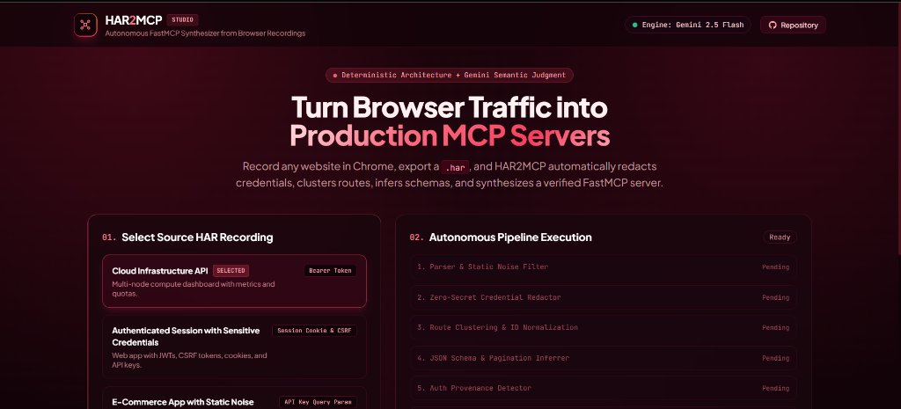
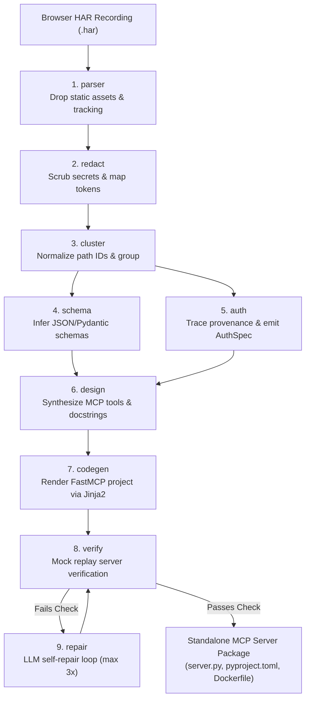

<div align="center">

# 🌐 HAR2MCP

### *Turn any browser network recording (`.har`) into a production-ready, type-safe Model Context Protocol (MCP) server.*

[](https://github.com/username/har2mcp/actions/workflows/ci.yml)
[](https://www.python.org/downloads/)
[](https://modelcontextprotocol.io/)
[](https://ai.google.dev/)
[](#development--testing)
[](https://github.com/astral-sh/ruff)
[](https://opensource.org/licenses/MIT)

<p>
  <a href="#-60-second-quickstart">Quickstart</a> •
  <a href="#-har2mcp-web-studio">Web Studio</a> •
  <a href="#%EF%B8%8F-architecture">Architecture</a> •
  <a href="#-the-pipeline-stages">Pipeline</a> •
  <a href="#-safety-model--ethics">Safety</a> •
  <a href="#-evaluation-benchmark-results">Benchmarks</a> •
  <a href="#%EF%B8%8F-roadmap">Roadmap</a>
</p>

</div>

---

## 🎯 The Problem

Web APIs power the modern software ecosystem, but the vast majority of useful APIs are **private, undocumented internal endpoints** built exclusively for web frontends. If you want an AI assistant (like **Claude Desktop**, **Cursor**, or **Antigravity**) to interact with a web service on your behalf, you typically face a tedious manual ordeal:

1. 🔍 Manually inspecting the browser Network tab.
2. 🔐 Deciphering undocumented session cookies, CSRF tokens, and query parameter structures.
3. 🧱 Writing boilerplate HTTP client code, error handling, and JSON schema models.
4. 📦 Packaging it into an MCP server conforming to the protocol specification.

**HAR2MCP automates this entire lifecycle.** Simply record yourself using any website in your browser, export a `.har` file, and HAR2MCP will automatically parse the traffic, redact all secrets, parameterize dynamic URLs, infer schemas, detect authentication flows, and generate a standalone Python **FastMCP** server ready for your AI agent.

---

## 🖥️ HAR2MCP Web Studio

Launch the built-in interactive studio (`uv run har2mcp ui`) to visualize the 8-stage synthesis pipeline, inspect Gemini-designed tools, and browse generated code in real time:

<div align="center">
  
</div>

---

## ⚡ 60-Second Quickstart

### 1. Installation

Requires **Python 3.11+** and [`uv`](https://github.com/astral-sh/uv):

```bash
# Clone the repository
git clone https://github.com/username/har2mcp.git
cd Any-website-to-MCP-server

# Install all dependencies into virtual environment
uv sync --all-extras
```

### 2. Generate Your First MCP Server (CLI)

```bash
# Generate a read-only server and verify against a local mock replay
uv run har2mcp generate eval/cases/case_01_synthetic_cloud/recording.har \
  --out ./my_cloud_server \
  --verify
```

### 3. Launch the Interactive Web Studio UI

```bash
uv run har2mcp ui
# Or: make ui
```

Opens `http://localhost:8080` in your browser, featuring:
- **Live 8-Stage Pipeline Stepper**: Real-time visual progress from noise filtering to Gemini tool design and mock verification.
- **Pre-Loaded Demonstrations**: One-click demo sessions (*Cloud Infrastructure*, *Authenticated Sessions*, *Mixed Traffic*) or drag-and-drop custom `.har` uploads.
- **Tabbed Code Explorer**: Live viewer for `server.py`, `pyproject.toml`, `.env.example`, `Dockerfile`, and `README.md`.
- **Tool Inspection**: Synthesized `@mcp.tool` signatures, argument types, and agent-oriented docstrings.

### 4. Run and Connect to Claude Desktop

Inspect your generated project in `./my_cloud_server`:

```bash
cd my_cloud_server

# Set up your environment credentials
cp .env.example .env
# Edit .env with your real API token or session cookie

# Launch the MCP server
uv run python server.py
```

Add the generated server to your Claude Desktop configuration (`claude_desktop_config.json`):

```json
{
  "mcpServers": {
    "my-service": {
      "command": "uv",
      "args": [
        "run",
        "--with",
        "mcp",
        "--with",
        "httpx",
        "python",
        "/absolute/path/to/my_cloud_server/server.py"
      ],
      "env": {
        "HAR2MCP_AUTH_TOKEN": "your-token-here"
      }
    }
  }
}
```

---

## 🏗️ Architecture

HAR2MCP follows a **Deterministic-First + LLM-for-Judgment** hybrid architecture: 100% deterministic code handles data parsing, secret redaction, URL clustering, and schema inference, while LLMs (**Gemini 2.5 Flash** or OpenAI) are used strictly where semantic judgment is required.



### Core Architectural Principles

| Principle | Implementation |
|:----------|:---------------|
| **Deterministic Core** | Parsing, URL normalization, `genson` JSON schema inference, and AST generation run deterministically in milliseconds with zero hallucinations. |
| **Zero-Secret LLM Policy** | All tokens, cookies, passwords, and JWTs are scrubbed locally into `<TOKEN_N>` placeholders *before* any LLM call. |
| **LLM for Judgment** | Gemini / OpenAI only handles semantic naming, agent-friendly docstrings, logical grouping, and targeted `--repair` patches. |
| **Offline Capable** | If no `GEMINI_API_KEY` or `OPENAI_API_KEY` is provided, HAR2MCP falls back cleanly to deterministic tool synthesis at `$0.00` cost. |

For a deep dive into design decisions and a walkthrough script, see [docs/ARCHITECTURE.md](docs/ARCHITECTURE.md) and [docs/demo.md](docs/demo.md).

---

## 📸 How to Export a HAR from Chrome DevTools

1. Open **Google Chrome** (or any Chromium browser) and navigate to your target website.
2. Open Developer Tools by pressing `F12` (`Ctrl+Shift+I` on Windows/Linux, `Cmd+Option+I` on macOS).
3. Switch to the **Network** tab at the top.
4. Check the **Preserve log** *(or **Keep log**)* checkbox in the toolbar.
5. *(Optional)* Click the **Clear** icon (`⊘`) to start with a clean log.
6. Perform the actions in the browser you want your AI agent to automate (e.g., searching, filtering, viewing records).
7. Click the **Export HAR** icon (`↓` downward arrow in the toolbar, or right-click any request row $\to$ **"Save all as HAR with content"**).
8. Save the file as `recording.har`.

> [!TIP]
> Keep your recording focused! Perform only 2–3 distinct actions you want tools generated for. Keeping the session tight produces the cleanest MCP tools.

---

## ⚙️ The Pipeline Stages

HAR2MCP executes nine modular, strictly typed stages:

| Stage | Module | Responsibility |
|:------|:-------|:---------------|
| **1. Parse** | `har2mcp.parser` | Ingests HAR JSON into Pydantic models. Drops images, CSS, fonts, scripts, media, and analytics/tracking domains via a configurable blocklist. |
| **2. Redact** | `har2mcp.redact` | Replaces secrets (`Authorization`, `Cookie`, `Set-Cookie`, CSRF tokens, API keys, passwords, and JWTs) with stable placeholders (`<TOKEN_1>`, `<COOKIE_2>`). **No secrets ever reach an LLM.** |
| **3. Cluster** | `har2mcp.cluster` | Normalizes dynamic path segments (integers, UUIDs, hashes, slugs) across samples into `{param}` templates. Separates stable vs. variable query params and splits GraphQL operations. |
| **4. Schema** | `har2mcp.schema` | Infers JSON schemas for requests, query params, and responses. Detects required fields, enums, timestamps, IDs, nullable fields, and pagination (`page`/`limit`, `offset`, `cursor`, `Link`). |
| **5. Auth** | `har2mcp.auth` | Traces token provenance across requests to classify auth (Bearer, Cookie session, API key, CSRF header) and produces an `AuthSpec` mapped to environment variables. |
| **6. Design** | `har2mcp.design` | Synthesizes user-meaningful MCP tools with `snake_case` names, agent docstrings, typed parameters, and read/write flags via Gemini/OpenAI or deterministic fallback. |
| **7. Codegen** | `har2mcp.codegen` | Renders a standalone FastMCP Python package using Jinja2 (`server.py`, `pyproject.toml`, `.env.example`, `README.md`, `Dockerfile`). |
| **8. Verify** | `har2mcp.verify` | Spins up a local mock replay server from the HAR entries, launches the generated MCP server over stdio, calls each tool, and checks response structures. |
| **9. Repair** | `har2mcp.verify.repair` | On verification failure, sends redacted failing tool code, error text, and expected vs. actual output to the LLM to patch the tool (up to 3 iterations). |

---

## 🛡️ Safety Model & Ethics

### 1. Zero-Secret LLM Leakage
All credentials—cookies, bearer tokens, API keys, passwords, and JWTs—are stripped and replaced with deterministic placeholders (`<TOKEN_1>`) locally **before** any prompt is constructed.

### 2. Read-Only by Default
Generated MCP servers only expose read methods (`GET`, `HEAD`). State-mutating operations (`POST`, `PUT`, `DELETE`, `PATCH`) are omitted unless you explicitly pass `--allow-writes`:

```bash
uv run har2mcp generate recording.har --out ./out --allow-writes
```

### 3. Ethical Use Policy
> [!IMPORTANT]
> **Use HAR2MCP only on websites and APIs that you own, operate, or have explicit permission to inspect and automate.**
> - Do not use HAR2MCP to scrape or interact with services in violation of their Terms of Service (ToS).
> - Respect rate limits, `robots.txt`, and API quotas.
> - HAR2MCP does not automate CAPTCHA solving, bot-detection bypasses, or anti-fraud circumvention.

---

## 📊 Evaluation Benchmark Results

HAR2MCP includes an automated benchmark suite (`eval/`) that evaluates precision, recall, schema field F1, auth accuracy, and verification pass rates against ground-truth OpenAPI specs and hand-written endpoint lists.

```bash
# Run the evaluation suite
make eval
# Or: uv run python eval/run_eval.py
```

### Overall Metrics

*Results pulled from [`eval/results.json`](eval/results.json):*

| Metric | Benchmark Result |
|:-------|-----------------:|
| **Evaluated Cases** | 1 / 1 completed *(Cases 02–10 ready placeholders)* |
| **Mean Endpoint Precision** | **100.0%** |
| **Mean Endpoint Recall** | **100.0%** |
| **Mean Endpoint F1** | **100.0%** |
| **Mean Schema Field F1** | **96.3%** |
| **Auth Detection Accuracy** | **100.0%** |
| **Tools Passing First Try** | **2 / 2 (100.0%)** |
| **Tools Passing After Repair** | **2 / 2 (100.0%)** |
| **Total LLM Cost** | **$0.0000** |
| **Execution Time** | **2.64s** |

### Case-by-Case Breakdown

| Case Name | Endpoints (P / R / F1) | Schema Field F1 | Auth Detected | First Try | After Repair | Cost | Time |
|:----------|:-----------------------|:----------------|:--------------|:----------|:-------------|:-----|:-----|
| `case_01_synthetic_cloud` | 100% / 100% / 100% | 96.3% | Yes (`bearer_token`) | 2 / 2 | 2 / 2 | $0.0000 | 2.64s |

*(Placeholders `case_02` through `case_10` in `eval/cases/` are pre-structured and await user-supplied HAR files and OpenAPI specs).*

---

## ⚠️ Known Limitations

Certain security architectures cannot be replayed statically without custom extensions:

- **Cryptographic Request Signing (HMAC / SigV4)**: APIs requiring per-request HMAC signatures (AWS SigV4, OAuth 1.0a, exchange APIs) need custom signing middleware hooked into the `httpx` client.
- **Interactive OAuth 2.0 / SSO**: HAR2MCP strictly adheres to *never automating logins*; tokens must be supplied via environment variables.
- **Anti-Bot & WAF Challenges**: Endpoints protected by Cloudflare Turnstile, DataDome, or JA3 TLS fingerprinting may reject standard Python HTTP clients.
- **Single-Use Nonces**: Short-lived rotating CSRF tokens may require a pre-request fetch hook.

See [docs/limitations.md](docs/limitations.md) for full details and recommended workarounds.

---

## 🗺️ Roadmap

- [x] Deterministic HAR parser with static asset & analytics filtering
- [x] Local zero-leakage secret & credential redaction engine
- [x] Dynamic path parameterization & endpoint clustering
- [x] Multi-sample JSON Schema & pagination pattern inference
- [x] Token provenance & auth mechanism detector
- [x] Provider-agnostic LLM client with disk cache, **Gemini 2.5 Flash**, and OpenAI support
- [x] Jinja2 FastMCP server code generation (`server.py`, `Dockerfile`, `.env.example`)
- [x] Automated local mock replay verification & self-repair loop
- [x] Standardized evaluation benchmark suite (`make eval`)
- [x] Interactive maroon AI Web Studio (`har2mcp ui`)
- [ ] Direct OpenAPI / Postman collection import
- [ ] Server-Sent Events (SSE) & WebSocket streaming endpoint support
- [ ] Interactive TUI for reviewing and tweaking inferred tools before codegen
- [ ] Automated one-click Claude Desktop & Cursor config injector (`har2mcp install`)

---

## 🧪 Development & Testing

```bash
# Run complete quality gate (ruff lint, format check, mypy, pytest, eval)
make all

# Run pytest suite with coverage
uv run pytest -v --cov=har2mcp

# Type check with mypy
uv run mypy src tests eval

# Code formatting and linting
uv run ruff check .
uv run ruff format .
```

---

## 📄 License

This project is licensed under the [MIT License](LICENSE).
