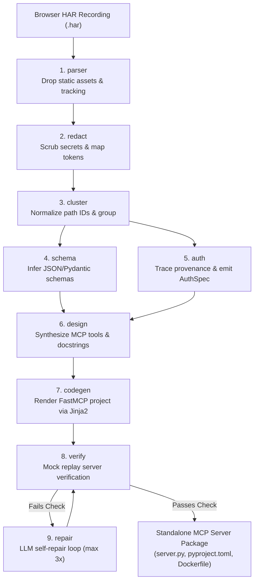

# HAR2MCP

> **Turn any browser network recording (`.har`) into a production-ready, type-safe Model Context Protocol (MCP) server.**

[](https://github.com/username/har2mcp/actions/workflows/ci.yml)
[](https://www.python.org/downloads/)
[](https://opensource.org/licenses/MIT)
[](https://github.com/astral-sh/ruff)

---

## The Problem

Web APIs power the modern software ecosystem, but the vast majority of useful APIs are private, undocumented internal endpoints built exclusively for web frontends. If you want an AI assistant (like Claude Desktop, Cursor, or Antigravity) to interact with a web service on your behalf, you typically face a tedious manual ordeal:
1. Manually inspecting the browser Network tab.
2. Deciphering undocumented session cookies, CSRF tokens, and query parameter structures.
3. Writing boilerplate HTTP client code, error handling, and JSON schema models.
4. Packaging it into an MCP server conforming to the protocol specification.

**HAR2MCP automates this entire lifecycle.** Simply record yourself using any website in your browser, export a HAR file, and HAR2MCP will automatically parse the traffic, redact all secrets, parameterize dynamic URLs, infer request and response schemas, detect authentication flows, and generate a standalone Python FastMCP server project ready for your AI agent.

---

## 60-Second Quickstart

### 1. Installation

Requires **Python 3.11+** and [`uv`](https://github.com/astral-sh/uv):

```bash
# Clone the repository
git clone https://github.com/username/har2mcp.git
cd Any-website-to-MCP-server

# Install all dependencies into virtual environment
uv sync --all-extras
```

### 2. Generate Your First MCP Server

```bash
# Generate a read-only server and verify against a local mock replay
uv run har2mcp generate eval/cases/case_01_synthetic_cloud/recording.har \
  --out ./my_cloud_server \
  --verify
```

### 3. Interactive Web Studio UI

HAR2MCP includes an AI-styled web interface for interactive demonstrations and visual pipeline execution:

```bash
uv run har2mcp ui
# Or: make ui
```

Opens `http://localhost:8080` in your browser, featuring:
- **Live 8-Stage Pipeline Stepper**: Real-time visual progress from noise filtering to Gemini tool design and mock verification.
- **Pre-Loaded Demonstrations**: One-click demo sessions (Cloud Infrastructure, Authenticated Sessions, Mixed Traffic) or drag-and-drop custom `.har` uploads.
- **Code Explorer**: Interactive tabbed viewer for `server.py`, `pyproject.toml`, `.env.example`, `Dockerfile`, and `README.md`.
- **Tool Inspection**: Live inspection of synthesized `@mcp.tool` signatures, argument types, and docstrings.

### 4. Run and Connect to Claude Desktop

Inspect your generated project in `./my_cloud_server`:

```bash
cd my_cloud_server

# Set up your environment credentials
cp .env.example .env
# Edit .env with your real API token or session cookie

# Launch the MCP server
uv run python server.py
```

Add the generated server to your Claude Desktop configuration (`claude_desktop_config.json`):

```json
{
  "mcpServers": {
    "my-service": {
      "command": "uv",
      "args": ["run", "--with", "mcp", "--with", "httpx", "python", "/absolute/path/to/my_cloud_server/server.py"],
      "env": {
        "HAR2MCP_AUTH_TOKEN": "your-token-here"
      }
    }
  }
}
```

Now Claude or any MCP client can interact with that service using typed, documented tools!

---

## Architecture Diagram

HAR2MCP uses a **hybrid architecture**: 100% deterministic algorithms for data-heavy tasks, and LLMs exclusively for semantic judgment.



For an in-depth design rationale, see [docs/demo.md](file:///c:/Users/tejag/OneDrive/Desktop/Any%20website%20to%20MCP%20server/Any-website-to-MCP-server/docs/demo.md) and [docs/ARCHITECTURE.md](file:///c:/Users/tejag/OneDrive/Desktop/Any%20website%20to%20MCP%20server/Any-website-to-MCP-server/docs/ARCHITECTURE.md).

---

## How to Export a HAR from Chrome DevTools

1. Open **Google Chrome** (or any Chromium browser) and navigate to the website you want to interface with.
2. Open Developer Tools by pressing `F12` (or `Ctrl+Shift+I` on Windows/Linux, `Cmd+Option+I` on macOS).
3. Switch to the **Network** tab at the top.
4. Check the **Preserve log** checkbox in the toolbar.
5. *(Optional)* Click the **Clear** button (the circle with a diagonal slash) to clear existing network traffic.
6. Perform the actions in the browser you wish your AI agent to automate (e.g., viewing records, searching items, listing dashboards).
7. In the Network tab toolbar, click the **Export HAR** icon (a downward arrow pointing to a tray, or right-click any network request and select **"Save all as HAR with content"**).
8. Save the file to your workspace as `recording.har`.

> [!TIP]
> Keep your recording focused! Perform only the actions you want tools generated for. If your recording includes browsing unrelated tabs or streaming media, HAR2MCP's parser will filter most static noise, but keeping the session tight produces the cleanest MCP tools.

---

## The Pipeline Stages

HAR2MCP runs through nine distinct, well-tested stages:

| Stage | Module | Responsibility |
|:------|:-------|:---------------|
| **1. Parse** | `har2mcp.parser` | Ingests HAR JSON into Pydantic models. Filters out images, CSS, fonts, scripts, audio/video, and analytics/tracking domains using an extensible domain blocklist. |
| **2. Redact** | `har2mcp.redact` | Replaces secrets (`Authorization`, `Cookie`, `Set-Cookie`, CSRF tokens, API keys in query/headers, passwords, and JWTs) with deterministic placeholders (`<TOKEN_1>`, `<COOKIE_2>`) while maintaining an internal mapping. **No secrets ever reach an LLM.** |
| **3. Cluster** | `har2mcp.cluster` | Normalizes dynamic URL path segments (integers, UUIDs, hashes, slugs) across multiple samples into `{param}` placeholders. Separates stable from variable query parameters and splits GraphQL operations. |
| **4. Schema** | `har2mcp.schema` | Infers JSON schemas for request bodies, query parameters, and response bodies across all samples. Detects enums, timestamps, IDs, nullable fields, and pagination patterns (page/limit, offset, cursor, Link headers). |
| **5. Auth** | `har2mcp.auth` | Traces token provenance to detect how authentication functions (Bearer token, cookie session, API key, CSRF header) and produces an `AuthSpec` mapping credentials to environment variables. |
| **6. Design** | `har2mcp.design` | Synthesizes user-meaningful MCP tool specifications with snake_case names, concise agent docstrings, typed arguments, and read/write classifications using an LLM or deterministic fallback. |
| **7. Codegen** | `har2mcp.codegen` | Renders a production-ready FastMCP Python package using Jinja2 templates (`server.py`, `pyproject.toml`, `.env.example`, `README.md`, `Dockerfile`). Oplocks write methods unless `--allow-writes` is specified. |
| **8. Verify** | `har2mcp.verify` | Spins up a local mock replay server from the HAR entries, starts the generated MCP server via stdio, and calls each tool to verify output structures against recorded responses. |
| **9. Repair** | `har2mcp.verify.repair` | If any tool fails verification, an autonomous repair loop sends the redacted failing tool code, error message, and expected output to the LLM to patch the code (up to 3 iterations). |

---

## Safety Model & Ethics

HAR2MCP is engineered with security and safety as top priorities:

### 1. Zero-Secret LLM Policy
All sensitive credentials—including cookies, bearer tokens, API keys, passwords, and JSON web tokens—are sanitized and replaced with stable identifiers (`<TOKEN_1>`) on your local machine **before** any data is sent to an LLM. Your actual secrets remain strictly on your local machine.

### 2. Read-Only by Default
Generated MCP servers only expose read methods (`GET`, `HEAD`). State-mutating operations (`POST`, `PUT`, `DELETE`, `PATCH`) are excluded by default to prevent accidental data modification. To explicitly generate mutation tools, you must pass the `--allow-writes` flag:
```bash
uv run har2mcp generate recording.har --out ./out --allow-writes
```

### 3. Ethical Use Policy
> [!IMPORTANT]
> **Use HAR2MCP only on websites and APIs that you own, operate, or have explicit permission to inspect and automate.**
> - Do not use HAR2MCP to scrape or interact with services in violation of their Terms of Service (ToS).
> - Respect rate limits, robots.txt, and API quotas.
> - HAR2MCP does not automate CAPTCHA solving, bot-detection bypasses, or anti-fraud circumvention.

---

## Evaluation Benchmark Results

HAR2MCP includes an evaluation suite (`eval/`) that benchmarks generated servers against ground-truth OpenAPI specifications and recorded sessions across precision, recall, schema accuracy, and execution cost.

```bash
# Run the evaluation suite
make eval
# Or: uv run python eval/run_eval.py
```

### Overall Metrics

*Results generated from [eval/results.json](file:///c:/Users/tejag/OneDrive/Desktop/Any%20website%20to%20MCP%20server/Any-website-to-MCP-server/eval/results.json):*

| Metric | Benchmark Result |
|:-------|-----------------:|
| **Evaluated Cases** | 1 / 1 completed *(Cases 02–10 ready placeholders)* |
| **Mean Endpoint Precision** | **100.0%** |
| **Mean Endpoint Recall** | **100.0%** |
| **Mean Endpoint F1** | **100.0%** |
| **Mean Schema Field F1** | **96.3%** |
| **Auth Detection Accuracy** | **100.0%** |
| **Tools Passing First Try** | **2 / 2 (100.0%)** |
| **Tools Passing After Repair** | **2 / 2 (100.0%)** |
| **Total LLM Cost** | **$0.0000** |
| **Execution Time** | **2.64s** |

### Case-by-Case Breakdown

| Case Name | Endpoints (P / R / F1) | Schema Field F1 | Auth Detected | First Try | After Repair | Cost | Time |
|:----------|:-----------------------|:----------------|:--------------|:----------|:-------------|:-----|:-----|
| `case_01_synthetic_cloud` | 100% / 100% / 100% | 96.3% | Yes (`bearer_token`) | 2 / 2 | 2 / 2 | $0.0000 | 2.64s |

*(Placeholders `case_02` through `case_10` in `eval/cases/` are pre-structured and await user-supplied HAR files and OpenAPI specs).*

---

## Known Limitations

While HAR2MCP automates the vast majority of web APIs, certain web architectures cannot be statically replayed without manual configuration:

- **Cryptographic Request Signing (HMAC / SigV4)**: APIs that require per-request cryptographic hashing (AWS SigV4, OAuth 1.0a, crypto exchange APIs) cannot be executed via static tokens alone; custom signing middleware must be added.
- **Interactive OAuth 2.0 / SSO**: HAR2MCP adheres to the rule: *never automate logins*. Credentials must be supplied via environment variables.
- **Anti-Bot & WAF Challenges**: APIs behind active bot mitigation (Cloudflare Turnstile, DataDome, Akamai JA3 fingerprinting) may block headless HTTP clients.
- **Single-Use Nonces**: Short-lived or rotating CSRF tokens may require a pre-request fetch hook.

See [docs/limitations.md](file:///c:/Users/tejag/OneDrive/Desktop/Any%20website%20to%20MCP%20server/Any-website-to-MCP-server/docs/limitations.md) for full architectural analysis and recommended workarounds.

---

## Roadmap

- [x] Deterministic HAR parser with static asset & analytics filtering
- [x] Local zero-leakage secret & credential redaction engine
- [x] Dynamic path parameterization & endpoint clustering
- [x] Multi-sample JSON Schema & pagination pattern inference
- [x] Token provenance & auth mechanism detector
- [x] LLM tool designer with prompt caching & Pydantic validation
- [x] Jinja2 FastMCP server code generation
- [x] Automated local mock replay verification & self-repair loop
- [x] Standardized evaluation benchmark suite with Markdown/JSON reporting
- [ ] Direct OpenAPI / Postman collection import
- [ ] Server-Sent Events (SSE) & WebSocket streaming endpoint support
- [ ] Interactive TUI for reviewing and tweaking inferred tools before codegen
- [ ] Automated one-click Claude Desktop & Cursor config injector (`har2mcp install`)

---

## Development & Testing

```bash
# Run complete quality gate (linter, format check, type checker, tests)
make all

# Run pytest suite with coverage
uv run pytest -v --cov=har2mcp

# Type check with mypy
uv run mypy src tests eval

# Code formatting and linting
uv run ruff check .
uv run ruff format .
```

---

## License

This project is licensed under the [MIT License](LICENSE).
