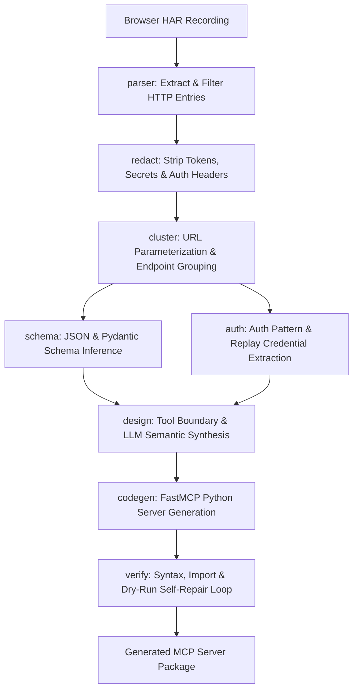

# HAR2MCP Architecture

HAR2MCP turns browser HAR (HTTP Archive) network recordings into clean, production-ready Model Context Protocol (MCP) servers.

## Architectural Principles

1. **Deterministic Code First**: Parsing, URL clustering, JSON schema inference, and AST generation run deterministically. LLMs are applied strictly where semantic human judgment is necessary:
   - Tool naming and operation ID refinement
   - Tool description and parameter docstrings
   - Logical tool grouping
   - Autonomous syntax/import repair loop

2. **Zero-Secret LLM Policy**: Redaction occurs before any data payload or metadata reaches an LLM. Cookies, Authorization tokens, bearer tokens, API keys, and sensitive payload values are replaced with deterministic placeholders or isolated into local environment variable configurations.

3. **Safe Defaults (Read-Only)**: Generated MCP servers expose strictly read-only tools (`GET`, `HEAD`) by default. Mutation tools (`POST`, `PUT`, `DELETE`, `PATCH`) require the explicit CLI flag `--allow-writes`.

4. **Modular & Verifiable**: Every module is accompanied by isolated pytest test suites, full static typing, and Pydantic validation models.

5. **Provider-Agnostic LLM Interface**: All model interactions are routed through `src/har2mcp/llm/client.py`, enabling zero-overhead provider swapping (Anthropic, OpenAI, Gemini, local models).

## Pipeline Modules

| Module | Responsibility |
|---|---|
| `parser` | Ingests HAR JSON, filters out static assets (images, stylesheets, fonts, analytics tracking). |
| `redact` | Sanitizes cookies, bearer tokens, custom auth headers, and common PII patterns. |
| `cluster` | Normalizes dynamic URL path segments (`/users/123` -> `/users/{id}`) and groups related endpoints. |
| `schema` | Infers Pydantic models and JSON schemas from observed query parameters and request/response bodies. |
| `auth` | Detects session cookies, API tokens, or headers and produces a runtime `.env` template. |
| `design` | Filters operations, synthesizes readable tool names, and produces tool descriptions. |
| `codegen` | Renders a standalone FastMCP Python package with typed tools, docstrings, and HTTP client logic. |
| `verify` | Validates generated code syntax, runs linter checks, and invokes the repair loop if errors are detected. |
| `llm` | Defines the unified `BaseLLMClient` protocol and provider implementations. |
| `cli` | Exposes the command-line interface (`har2mcp generate <file.har> --out ./out`). |
